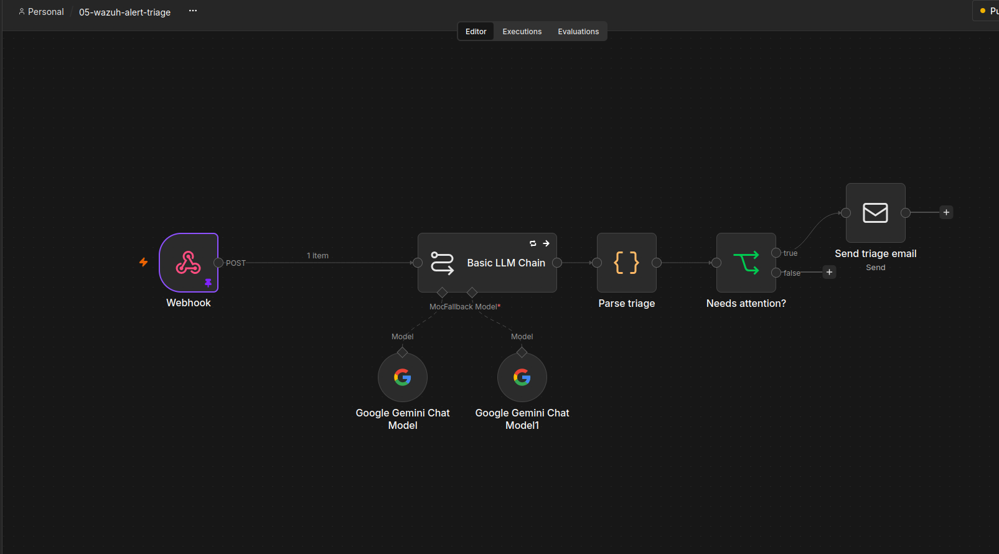

# n8n Security Automation Lab

Automation workflows for security operations, built with n8n and self-hosted in Docker. This repo collects the workflows I build while learning AI agents and automation, with a focus on security use cases.

## Workflows

### 01 - RSS Security News Digest

File: `rss-security-digest.json`

Reads a security news feed, keeps only articles that match security keywords, and emails a single digest.

Pipeline:

1. **Manual trigger** starts the run
2. **Read security feed** pulls the articles from an RSS feed
3. **Filter by keywords** keeps titles matching ransomware, phishing, vulnerability, zero-day, breach, exploit, attack, malware or CVE
4. **Keep useful fields** reduces each article to title, link and publication date
5. **Build digest** (JavaScript) merges all articles into one email body
6. **Send digest email** sends the result over SMTP

Example run: 15 articles read, 10 kept by the filter, 1 digest email sent.

### 02 - AI Security Digest (Gemini)

File: `ai-security-digest.json`

Same pipeline as workflow 01, with an AI step. Instead of a plain list, Google Gemini writes a short briefing for a network security engineer: the 3 most important articles first, each with a one-line "why it matters", then the remaining articles as short bullets with links.

Pipeline:

1. **Manual trigger**, **Read security feed**, **Filter by keywords**, **Keep useful fields**, **Build digest** (same as workflow 01)
2. **Basic LLM Chain** with a Google Gemini chat model writes the briefing from the digest
3. **Send digest email** sends the briefing over SMTP

Notes:

- Requires a free Gemini API key from Google AI Studio, added as a credential in n8n.
- Retry On Fail is enabled on the LLM node (5 tries, 5 seconds apart), because the free tier regularly returns 503 errors during high demand.
- Only public data (news headlines and links) is sent to the model.

### 03 - Wazuh Alert Triage (Gemini)

File: `wazuh-alert-triage.json`. Integration scripts: [`wazuh-integration/`](wazuh-integration/README.md)

Receives alerts from a self-hosted Wazuh manager, has Gemini triage each one, and emails only the ones that need attention.

Pipeline:

1. **Webhook** receives the alert JSON, sent by a custom Wazuh integration (throttled, level 8 and above)
2. **Basic LLM Chain** (Gemini, with a second model as fallback) returns severity, category, a one-sentence summary, a likely false positive verdict and a recommended action. The prompt tells the model to treat alert content as untrusted data
3. **Parse triage** (JavaScript) turns the answer into separate fields. If the AI call fails, severity becomes `unknown`
4. **Needs attention?** passes every alert except `low`
5. **Send triage email** sends the triage over SMTP

Design decisions:

- An alert is never lost because the AI is down: Retry On Fail, a fallback model, and On Error set to Continue. If both models fail, I still get an email with severity `unknown` and the original rule description.
- Throttling lives in the Wazuh integration, not in n8n. The reasoning is in the integration README.
- The threshold is level 8. At level 5, one Windows host produced over 2,000 alerts in a single day, mostly audit failures and registry integrity events.
- The workflow only sends email. There are no automated response actions, a human decides.

Test: creating, changing and deleting a local Windows test account produced 3 forwarded alerts and 3 triage emails. Running the integration script 3 times with the same alert sent 1 request.

## Run it yourself

1. Start n8n with Docker Compose, bound to localhost only (`127.0.0.1:5678`)
2. In n8n, import a workflow JSON from this repo (workflow menu, then Import)
3. Create your own SMTP credential (for Gmail, use an app password without spaces)
4. For workflows 02 and 03, also create a Google Gemini credential with a free API key from Google AI Studio
5. Replace `your-email@example.com` in the Send email node with your address
6. Workflows 01 and 02 run manually. For workflow 03, install the integration from `wazuh-integration/` on your Wazuh manager and publish the workflow

## Security notes

- No credentials or API keys are stored in this repo. The exported JSON files contain only credential names, never secrets.
- Email addresses and internal IP addresses in the exports are replaced with placeholders.
- n8n listens on localhost only. The Wazuh integration talks to it over localhost.
- SMTP uses an app password instead of the account password.
- Workflows 02 and 03 send data to a third-party model API (Gemini free tier). Workflow 02 only sends public news. Workflow 03 sends alert content (hostnames, usernames, IP addresses), so use it on lab data only, or switch to a local model for real environments.
- Alert fields can be controlled by an attacker, so the triage prompt treats them as untrusted input. It has not been red-teamed yet (see roadmap).

## Roadmap

- Phishing email triage agent
- Security testing of my own agents (prompt injection against the triage prompt, least privilege, logging)
- Alert enrichment (IP reputation) before triage, and a human approval step for response actions
- Local model option, so alert data never leaves the lab
