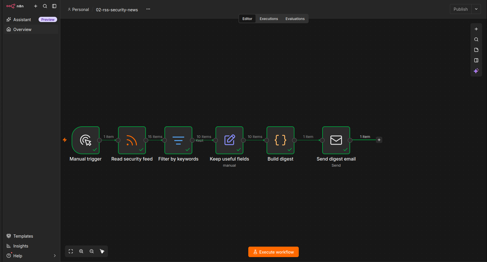

# n8n Security Automation Lab

Automation workflows for security operations, built with n8n and self-hosted in Docker. This repo collects the workflows I build while learning AI agents and automation, with a focus on security use cases.

## Workflows

### 01 - RSS Security News Digest

File: `rss-security-digest.json`

Reads a security news feed, keeps only articles that match security keywords, and emails a single digest.

Pipeline:

1. **Manual trigger** starts the run
2. **Read security feed** pulls the articles from an RSS feed
3. **Filter by keywords** keeps titles matching ransomware, phishing, vulnerability, zero-day, breach, exploit, attack, malware or CVE
4. **Keep useful fields** reduces each article to title, link and publication date
5. **Build digest** (JavaScript) merges all articles into one email body
6. **Send digest email** sends the result over SMTP

Example run: 15 articles read, 10 kept by the filter, 1 digest email sent.

## Run it yourself

1. Start n8n with Docker Compose, bound to localhost only (`127.0.0.1:5678`)
2. In n8n, import `rss-security-digest.json` (workflow menu, then Import)
3. Create your own SMTP credential (for Gmail, use an app password)
4. Replace `your-email@example.com` in the Send digest email node with your address
5. Run the workflow

## Security notes

- No credentials or API keys are stored in this repo. The exported JSON contains only credential names, never secrets.
- Email addresses in the export are replaced with placeholders.
- n8n listens on localhost only and is not exposed to the network.
- SMTP uses an app password instead of the account password.

## Roadmap

- Wazuh alert triage agent (enrich, classify, summarize, human approval for response actions)
- Phishing email triage agent
- Security testing of my own agents (prompt injection, least privilege, logging)
